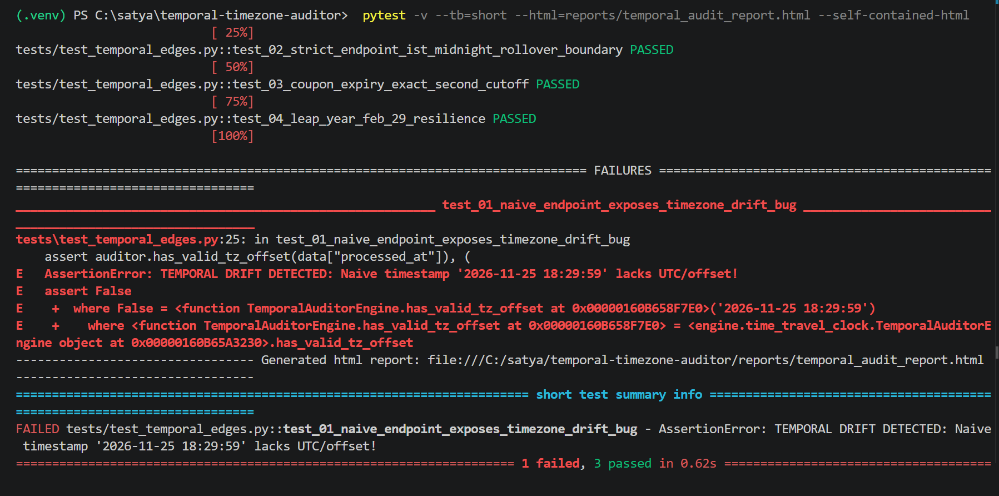
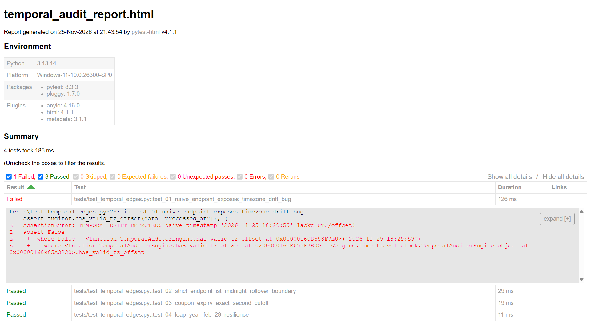
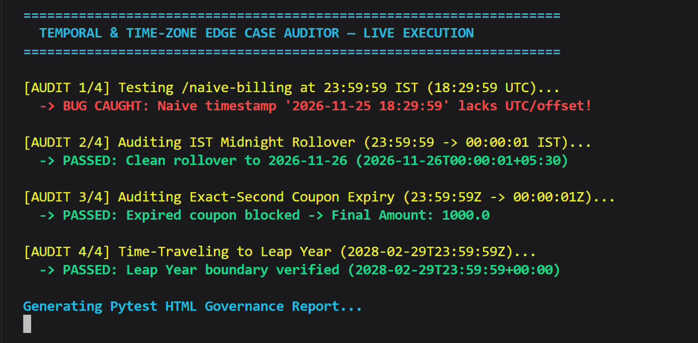

# ⏳ Temporal & Time-Zone Edge Case Auditor

An automated SDET governance and time-travel auditing framework built with **Python, FastAPI, Pytest, and Freezegun** to detect timezone-naive timestamp drift, IST/UTC midnight rollover bugs, exact-second coupon expiry leaks, and Leap Year boundary failures before production deployment.

---

## 🎯 Why This Matters in Production
Distributed systems frequently suffer from silent data corruption when local server clocks (`datetime.now()`) mix with global UTC timestamps:
- **Cross-Region Ledger Drift:** A transaction at `23:59:59 IST` (`18:29:59 UTC`) logged without explicit timezone offsets creates date mismatches across billing ledgers.
- **Boundary Expiry Leaks:** Off-by-one second checks around `23:59:59Z -> 00:00:01Z` allow expired discounts or warranties to slip through.
- **Leap Year Regressions:** Hardcoded date math crashes on `Feb 29` boundaries.

---

## 🏗️ Architecture & Audit Matrix

| Audit Check | Target Endpoint | Simulated Clock (`UTC`) | Expected Outcome |
| :--- | :--- | :--- | :--- |
| **1. Timezone-Naive Drift Detection** | `POST /naive-billing` | `2026-11-25T18:29:59Z` | **FAIL (Bug Caught):** Emits naive string lacking `Z` / offset |
| **2. IST Midnight Rollover (`23:59:59 -> 00:00:01`)** | `POST /strict-utc-billing` | `18:29:59Z` → `18:30:01Z` | **PASS:** Accurate ledger rollover (`Nov 25` → `Nov 26 IST`) |
| **3. Exact-Second Coupon Cutoff** | `POST /strict-utc-billing` | `23:59:59Z` → `00:00:01Z` | **PASS:** Discount active at `:59`, revoked at `:01` |
| **4. Leap Year Feb 29 Resilience** | `POST /strict-utc-billing` | `2028-02-29T23:59:59Z` | **PASS:** Zero date-overflow errors |

---

## 📊 Execution Proof

### 1. Terminal Audit Output (`1 Intentional Bug Caught, 3 Hardened Checks Passed`)


### 2. Self-Contained Pytest HTML Governance Report


### 3. Live Time-Travel Showcase Output


---

## 🚀 Quick Start

```bash
# 1. Clone & activate virtual environment
git clone https://github.com/satyanarayana51115/temporal-timezone-auditor.git
cd temporal-timezone-auditor

python -m venv venv
venv\Scripts\activate

# 2. Install dependencies
pip install -r requirements.txt

# 3. Run deterministic time-travel audit & generate HTML report
pytest -v --tb=short --html=reports/temporal_audit_report.html --self-contained-html

```

## 🔗 Automation Portfolio

​Live Portfolio: https://satyanarayana51115.github.io/satya-automation-portfolio/